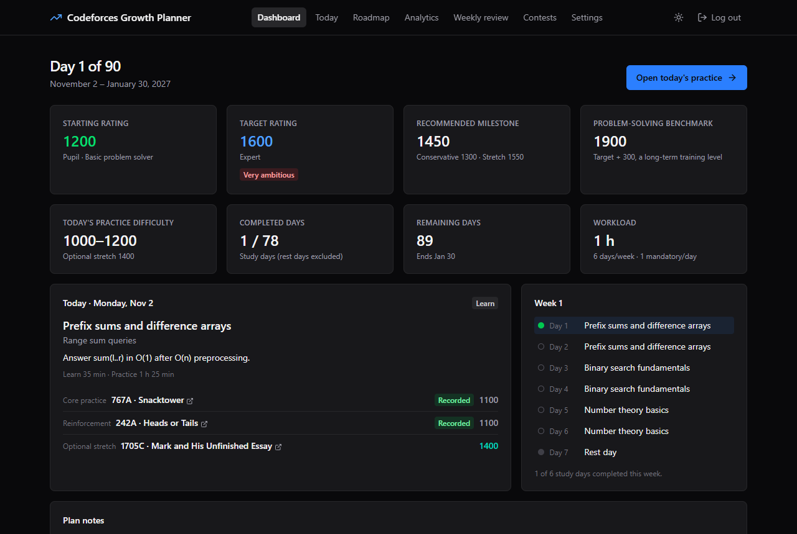
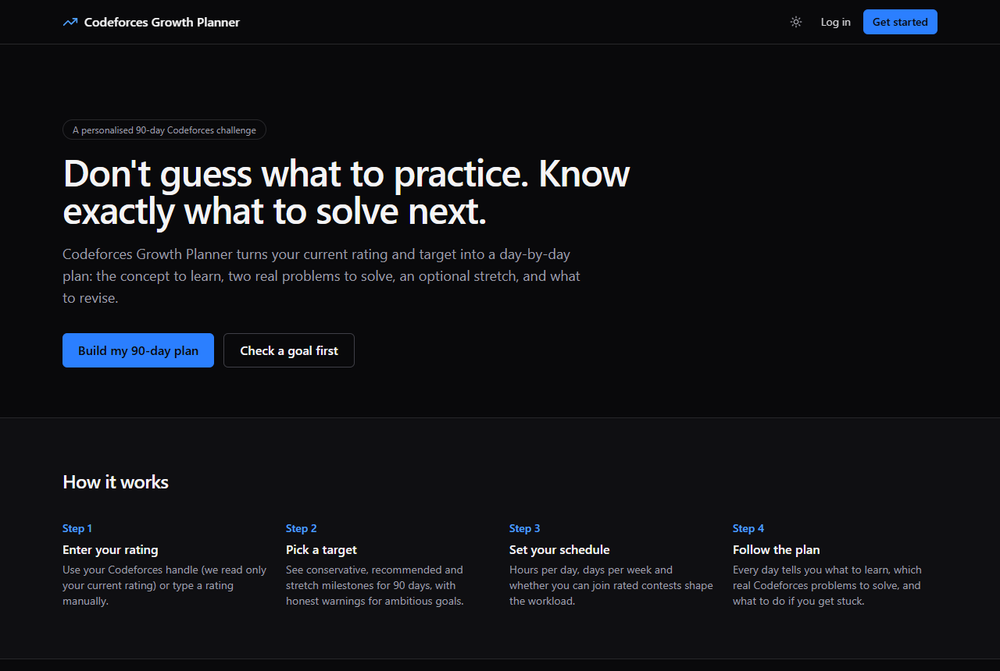
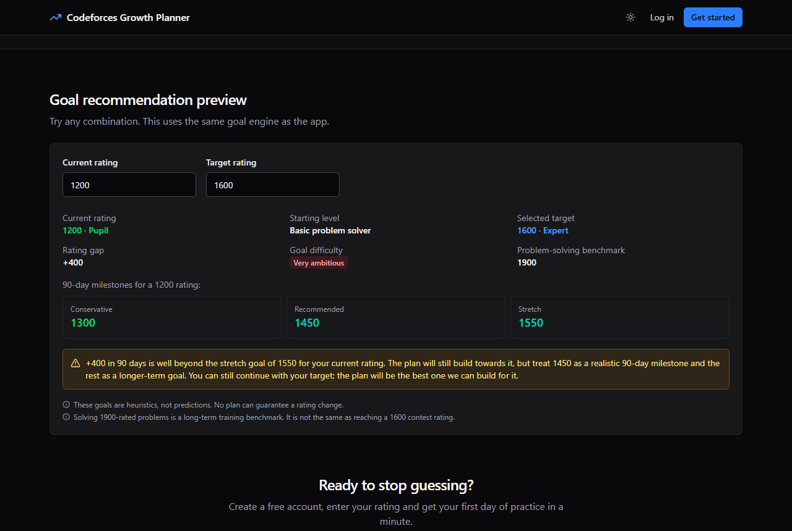
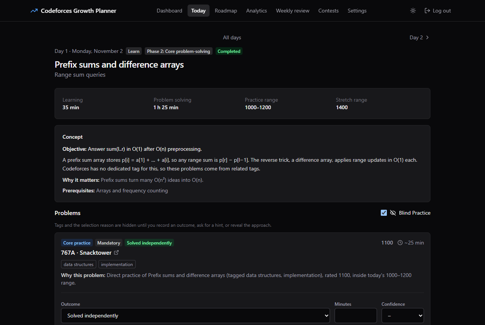
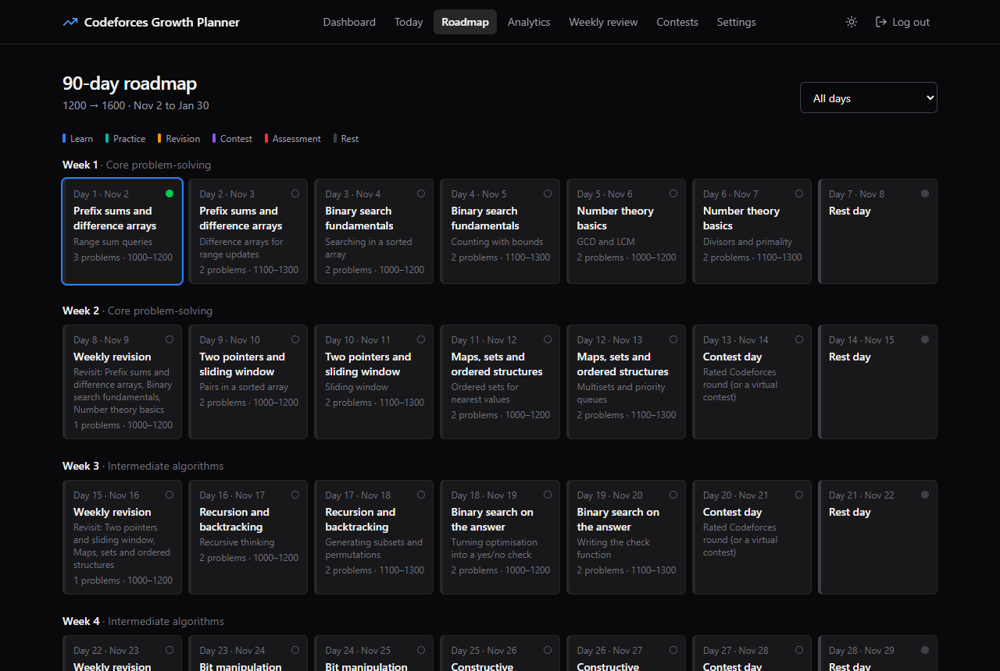
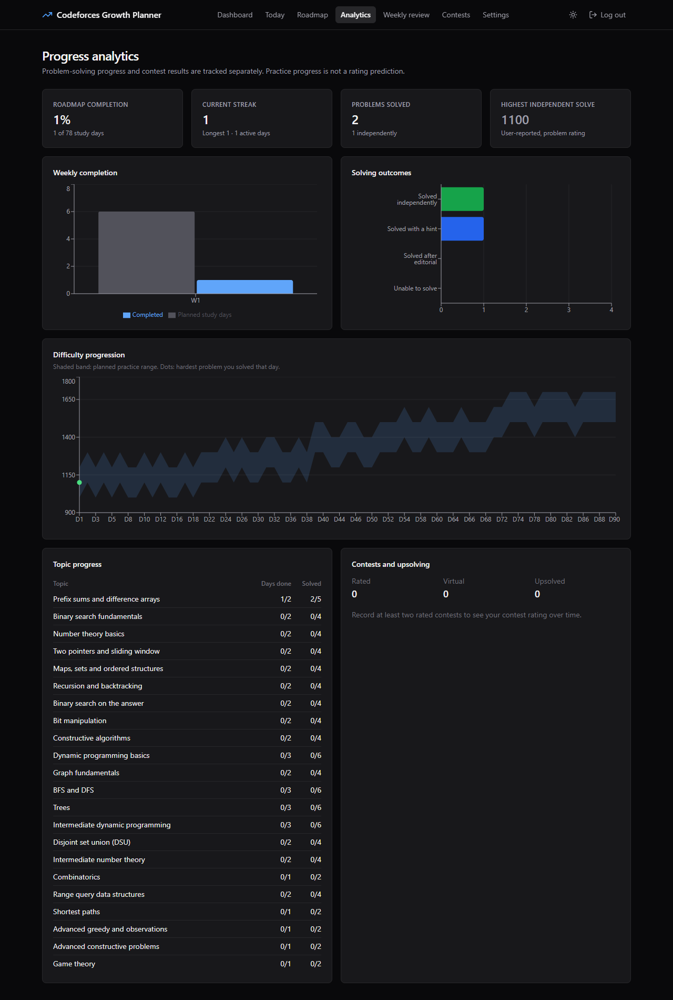
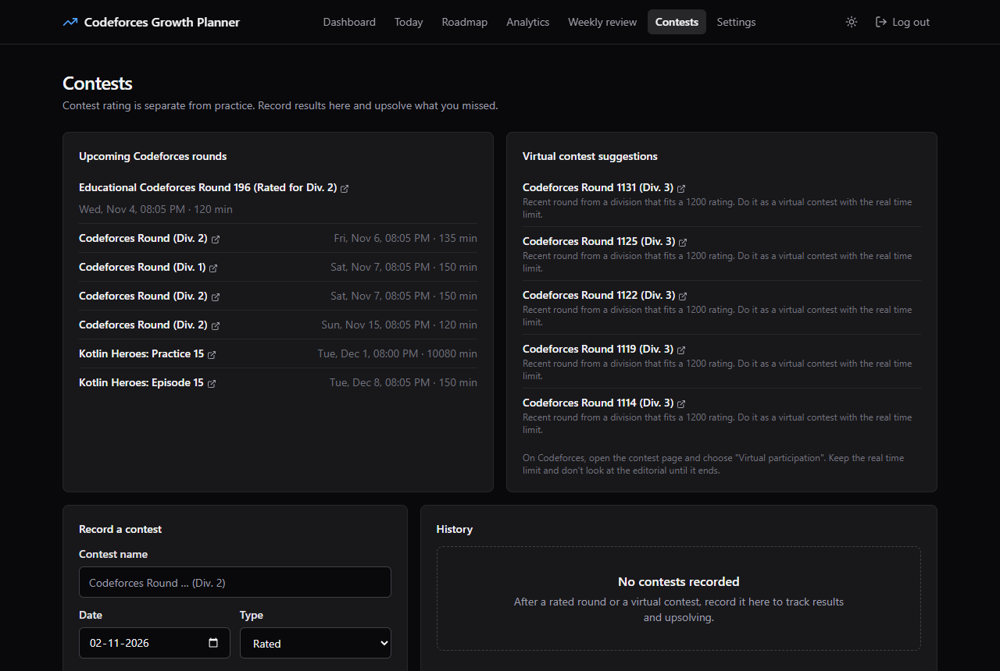
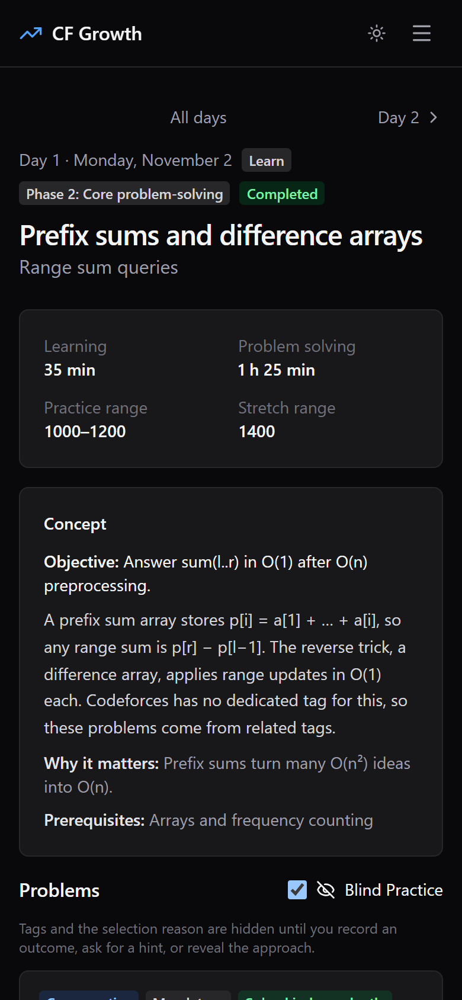
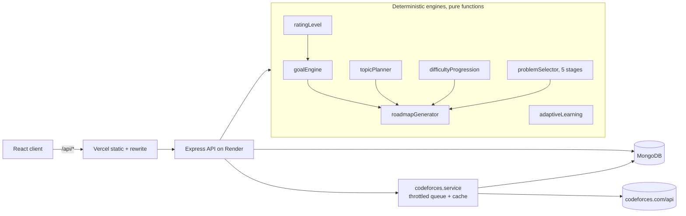

# Codeforces Growth Planner

**Don't guess what to practice. Know exactly what to solve next.**

A personalised 90-day training planner for Codeforces. You give it your current rating (or your handle), a target rating and the time you have; it builds a day-by-day plan with the concept to learn, real Codeforces problems to solve, an optional stretch problem, revision tasks, contest days and what to do when you get stuck. It then tracks how you solve, not just whether you solved, and adapts the remaining days to your feedback.



## Contents

1. [Problem statement](#problem-statement)
2. [Features](#features)
3. [Screenshots](#screenshots)
4. [Tech stack](#tech-stack)
5. [Architecture](#architecture)
6. [Installation and local setup](#installation-and-local-setup)
7. [Environment variables](#environment-variables)
8. [API](#api)
9. [Database design](#database-design)
10. [Rating-based goal engine](#rating-based-goal-engine)
11. [The target + 300 benchmark](#the-target--300-benchmark)
12. [Roadmap generation](#roadmap-generation)
13. [Problem selection](#problem-selection)
14. [Adaptive learning](#adaptive-learning)
15. [Testing](#testing)
16. [Deployment](#deployment)
17. [Limitations](#limitations)
18. [Future improvements](#future-improvements)

## Problem statement

Most competitive programmers below Candidate Master lose time deciding *what* to practise: which topic next, which of 10,000+ problems, how hard, and when to stop learning and start doing contests. Random practice leads to repetitive problems at the wrong level and no sense of progress.

This project turns that decision into a plan. The plan is deterministic and explainable: every problem card says why it was chosen, every number on the dashboard has a defined meaning, and nothing promises a rating change.

## Features

- **Rating-only starting level.** The initial classification comes from the current rating alone (Newbie → Beginner, Pupil → Basic problem solver, …). Submission history is never fetched or analysed, not even for adaptation.
- **Realistic goals.** Conservative, recommended and stretch milestones for 90 days, a difficulty label for the chosen target, clear warnings for ambitious targets, and a maintenance mode when the target is below the current rating.
- **Target + 300 benchmark** kept separate from the target rating, the current practice difficulty and the highest problem you solved independently.
- **Personalised 90-day roadmap.** Topic order with prerequisites, a difficulty curve from your rating towards your target, weekly revision, rest days that match your availability, contest or virtual contest days with upsolving, and a final assessment.
- **Real problems only.** Problems come from the official `problemset.problems` API, cached in MongoDB, selected in five stages (topic, difficulty, quality, variety, exclusion).
- **Daily practice page.** Concept, objective, why it matters, prerequisites, time estimates, two mandatory problems plus an optional stretch (configurable), revision tasks and "if you get stuck" steps.
- **Blind Practice.** Hides tags and the selection reason until you record an outcome, ask for a hint or reveal the approach.
- **Honest tracking.** Solved independently / with a hint / after the editorial / unable to solve / not attempted, plus time, confidence and notes.
- **Adaptive plan.** Rolling feedback ("too easy", "too difficult", "need revision", …) shifts the difficulty of untouched future days or adds revision. One answer never changes the plan.
- **Replace or exclude problems.** Swap a problem for another that fits the same day, or mark it "already solved" so it is never assigned again.
- **Contests.** Upcoming rounds from the Codeforces API, virtual contest suggestions by division, result recording, upsolving counts.
- **Analytics and weekly review.** Completion, streaks, weekly completion, topic progress, solving outcomes, planned difficulty vs. hardest problem solved, contest history.
- **Settings.** Update target, hours, days per week, contests and mandatory problem count (untouched future days are regenerated), theme (light/dark/system), roadmap management, excluded problems, account deletion with all data.

## Screenshots

All screenshots are from the application running locally with live Codeforces data.

| Landing page | Goal assessment |
|---|---|
|  |  |
| **Daily practice** | **90-day roadmap** |
|  |  |
| **Analytics** | **Contests** |
|  |  |



## Tech stack

| Layer | Technology |
|---|---|
| Frontend | React 19, Vite, TypeScript, Tailwind CSS 4, React Router, TanStack Query, Recharts, Lucide |
| Backend | Node.js, Express 5, TypeScript, Zod, JSON Web Tokens, bcrypt |
| Database | MongoDB (Atlas in production) with Mongoose |
| External API | [Codeforces API](https://codeforces.com/apiHelp) |
| Testing | Vitest, Supertest, mongodb-memory-server |
| Deployment | Vercel (frontend), Render (API), MongoDB Atlas |

## Architecture



The repository is an npm workspace with three packages:

```text
shared/   API types and constants used by both sides
server/   Express API: config, routes, controllers, services, models, validators, tests
client/   React app: pages, components, context, hooks, services, utils
docs/     Architecture, API, engine and database documentation, screenshots
```

Engines are pure functions with no I/O, so they are deterministic and unit-tested in isolation. See [docs/ARCHITECTURE.md](docs/ARCHITECTURE.md).

## Installation and local setup

Requirements: Node.js 20+ (developed on Node 24) and npm.

```bash
git clone https://github.com/Rohanxploit/CODEFORCES-GROWTH-PLANNER.git
cd CODEFORCES-GROWTH-PLANNER
npm install
cp .env.example server/.env
```

Edit `server/.env` and set `JWT_SECRET` to a long random string:

```bash
node -e "console.log(require('crypto').randomBytes(48).toString('hex'))"
```

Start a database. Either point `MONGODB_URI` at MongoDB Atlas, or run a local MongoDB without installing it system-wide (it downloads the official `mongod` binary once and keeps data in `server/.mongo-data`):

```bash
npm run dev:db
```

Then, in two more terminals:

```bash
npm run dev:server
```

```bash
npm run dev:client
```

Open http://localhost:5173. The first roadmap takes a few seconds while the Codeforces problemset (~11,000 problems) is fetched and cached in MongoDB; later ones use the cache.

## Environment variables

Server (`server/.env`):

| Variable | Default | Purpose |
|---|---|---|
| `NODE_ENV` | `development` | `production` enables secure cookies |
| `PORT` | `5000` | API port |
| `MONGODB_URI` | (required) | MongoDB connection string |
| `JWT_SECRET` | (required, at least 32 chars) | Signs session tokens |
| `JWT_EXPIRES_IN` | `7d` | Session lifetime |
| `CORS_ORIGINS` | `http://localhost:5173` | Comma-separated allowed origins |
| `COOKIE_SAME_SITE` | `lax` | `lax` when `/api` is proxied (recommended), `none` for direct cross-site calls |
| `AUTH_RATE_LIMIT` | `20` | Login/register attempts per IP per 15 minutes |
| `TRUST_PROXY` | `1` | Proxy hops in front of the API (`2` behind the Vercel rewrite + Render) |
| `CODEFORCES_API_BASE` | `https://codeforces.com/api` | Codeforces API base URL |

Client: `VITE_API_BASE_URL` stays empty. Vite proxies `/api` in development and Vercel rewrites it in production.

The server validates its configuration with Zod on startup and refuses to start with a missing database URI or a short secret.

## API

All endpoints are under `/api`, take and return JSON, and return errors as `{ "error": { "code", "message", "details?" } }`. Everything except health, auth and goal analysis requires the session cookie.

| Area | Endpoints |
|---|---|
| Health | `GET /health` |
| Auth | `POST /auth/register`, `POST /auth/login`, `POST /auth/logout`, `GET /auth/me`, `PATCH /auth/me`, `DELETE /auth/me`, `DELETE /auth/me/excluded/:problemId` |
| Codeforces | `GET /codeforces/:handle` |
| Goals | `POST /goals/analyze`, `POST /goals/recommend` |
| Roadmaps | `POST /roadmaps/generate`, `GET /roadmaps`, `GET /roadmaps/:id`, `PATCH /roadmaps/:id`, `DELETE /roadmaps/:id`, `GET /roadmaps/:id/today`, `GET /roadmaps/:id/day/:dayNumber` |
| Problems | `GET /problems`, `POST /problems/exclude`, `POST /problems/replace` |
| Progress | `PATCH /progress/:dailyPlanId`, `PATCH /progress/:dailyPlanId/status`, `POST /progress/:dailyPlanId/feedback` |
| Contests | `GET /contests`, `POST /contests`, `GET /contests/history`, `PATCH /contests/:id`, `DELETE /contests/:id` |
| Analytics | `GET /analytics/:roadmapId`, `GET /analytics/:roadmapId/weekly-review` |

Request and response details: [docs/API.md](docs/API.md).

## Database design

| Collection | Holds | Key indexes |
|---|---|---|
| `users` | name, email, bcrypt hash (never returned), handle, latest rating, manual exclusions, preferences | `email` unique |
| `roadmaps` | starting rating and level, target and goals, benchmark, schedule, seed, difficulty offset, adaptation log | `userId, status, createdAt` |
| `dailyplans` | one document per day: type, phase, topic, concept, ranges, assigned problems (metadata snapshot), revision tasks, status, feedback | `roadmapId, dayNumber` unique; `userId` |
| `problems` | cached Codeforces problemset (id, name, rating, tags, solved count, URL, refresh time) | `problemId` unique; `rating, tags` |
| `progresses` | per problem per day: outcome, independent flag, editorial/hint used, time, confidence, notes | `dailyPlanId, problemId` unique; `userId, roadmapId` |
| `contests` | user-recorded rated or virtual contests: ratings, solved, upsolved, notes | `userId, contestDate` |

Every user-owned query filters by the `userId` from the session token. Details: [docs/DATABASE.md](docs/DATABASE.md).

## Rating-based goal engine

The starting level uses **only** the current rating:

| Rating | Rank | Classification |
|---|---|---|
| 0–1199 | Newbie | Beginner |
| 1200–1399 | Pupil | Basic problem solver |
| 1400–1599 | Specialist | Intermediate |
| 1600–1899 | Expert | Advanced |
| 1900–2099 | Candidate Master | Advanced problem solver |
| 2100–2299 | Master | High-level training |
| 2300+ | International Master or above | Advanced training |

Below 200 the plan starts with programming fundamentals. An unrated handle asks for a manual rating (0 for a new competitor).

Goals come from a configurable heuristic table ([`server/src/config/heuristics/goals.ts`](server/src/config/heuristics/goals.ts)), e.g. 1200–1399 → 1300 / 1450 / 1550. Above 2000 the engine extrapolates smaller gains (+50/+100/+150) and says so. A target is classified as maintenance, conservative, recommended, ambitious (above recommended) or very ambitious (above stretch). Ambitious targets get a warning and a suggested milestone, and you can still keep your own target. These are product heuristics, not validated predictions.

## The target + 300 benchmark

`problemSolvingBenchmark = targetRating + 300`. It is a training heuristic: to compete at rating X, work towards independently solving problems around X + 300. It is not an official Codeforces rule and not a guarantee.

The app keeps four numbers apart: target contest rating, problem-solving benchmark, today's practice difficulty, and the highest difficulty you report having solved independently. The benchmark only caps **optional stretch problems**. Their offset above the practice range grows from about +100 early to +300 at the end, so benchmark-level problems only appear late, if the plan reaches them at all.

## Roadmap generation

`generateRoadmap(catalog, input)` is deterministic: the same input, seed and catalog give the same 90 days.

1. **Calendar.** 90 calendar days. Rest days are spread across each week to match the chosen days per week. From week 2, one day per week is a contest day (rated rounds, or virtual contests from week 3 when rated contests aren't possible) and the first study day is weekly revision. The last study day is a final assessment.
2. **Topics.** A [topic library](server/src/config/heuristics/topics.ts) of 38 topics with prerequisites, entry ratings and real Codeforces tags. Topics more than 300 below your rating become revision material; topics up to 200 above the end of the difficulty ramp are included; prerequisites are pulled in and ordered with a topological sort. Topics are fitted into about three quarters of the content days; the rest becomes target-level mixed practice and, in the final 12%, timed mixed practice towards the benchmark.
3. **Difficulty.** The practice centre follows a smooth S-curve from your rating (minimum 800) to your target, capped at +700 over 90 days and slightly flatter under one hour a day. Normal days use centre ± 100. The first day of each topic and revision days are easier, so the curve is intentionally not monotonic.
4. **Workload.** Learning time is about 30% of daily time on topic days. Mandatory problems default to 1 under 1.5 h, 2 by default and 3 from 4 h (or your own choice). The stretch problem is offered from 1 h a day.

So a 0-rated beginner starts with fundamentals and 800-rated problems, a 1200 Pupil starts with prefix sums, binary search and number theory at 1000–1200, and a 1700 Expert starts with BFS/DFS and trees at 1500–1700. Full details: [docs/ROADMAP_ENGINE.md](docs/ROADMAP_ENGINE.md).

## Problem selection

Each day picks a core problem, one or two reinforcement problems and an optional stretch problem from the cached problemset:

1. **Topic relevance:** must carry a topic tag; problems where the topic tag is most of the tags score higher.
2. **Difficulty:** inside the day's range; unrated problems are never assigned.
3. **Quality:** `0.45·relevance + 0.25·difficulty fit + 0.20·solved-count signal + 0.10·seeded jitter`. The solved count is log-scaled within the same rating and missing counts are neutral.
4. **Variety:** the reinforcement problem must come from a different contest with a different tag mix (Jaccard < 0.75), with a relaxed fallback.
5. **Exclusion:** nothing already in the roadmap, nothing you excluded, and no Div. 1/Div. 2 twins (same name in a nearby contest).

If nothing fits, the range widens by 100, then 200, then related tags are tried. Every fallback is written into the problem's "why this problem" text. URLs are always `https://codeforces.com/problemset/problem/{contestId}/{index}`. Full details: [docs/PROBLEM_SELECTION.md](docs/PROBLEM_SELECTION.md).

## Adaptive learning

After each day you can give feedback: too easy, appropriate, too difficult, need revision, understood, need more examples. The engine looks at the last 5 days with feedback (after the previous adaptation) and acts only with at least 3 of them:

- average ≥ 0.6 → upcoming problems +100 (up to +200 in total)
- average ≤ −0.6 → upcoming problems −100 (down to −200)
- revision requested on ≥ 2 days → extra revision tasks on the next study days

Difficulty changes regenerate only future days you haven't touched. The starting rating and classification never change, and submission history is never used.

## Testing

```bash
npm test
```

176 tests in 7 files, all passing on the latest run:

| Suite | Covers |
|---|---|
| `goalEngine.test.ts` | Classification at 0, 100, 200, 500, 800, 1000, 1200, 1400, 1600, 1900, 2100, 2300; all goal bands; warnings; maintenance; invalid targets; benchmark values |
| `codeforces.test.ts` | Invalid/unknown/unrated handles, timeouts, HTTP 429 and "Call limit exceeded", outages, caching, request spacing, problemset normalisation, stale-cache fallback |
| `problemSelector.test.ts` | Topic and difficulty filtering, missing ratings/tags/solved counts, scoring, variety, exclusions, Div. 1/Div. 2 twins, no candidates, determinism |
| `roadmapGenerator.test.ts` | Exactly 90 days, different plans per rating and target, hours and weekly availability, prerequisites, difficulty progression, no early stretch, no duplicates, valid metadata and URLs |
| `adaptiveAndAnalytics.test.ts` | Rolling-window adaptation, day status, analytics, weekly review, contest suggestions |
| `api.test.ts` | Password hashing, invalid login, validation, protected routes, forged tokens, rate limiting, user data isolation, full roadmap lifecycle, account deletion (in-memory MongoDB) |
| `app.test.ts` | Health, CORS, JSON errors, environment validation |

Engine tests use a synthetic catalog for determinism. To check the generator against the **live** problemset:

```bash
npm run verify:problemset -w server
```

The latest run generated plans for six profiles (0 → 400 through 2000 → 2150) with no unfilled slots, no duplicates, metadata matching the catalog and correctly formed URLs. Codeforces answers automated page requests with HTTP 403, so links were also spot-checked by opening them in a browser.

## Deployment

The frontend deploys to Vercel, the API to Render, and data to MongoDB Atlas. Vercel rewrites `/api/*` to Render, so the session cookie stays first-party. Step-by-step guide: [docs/DEPLOYMENT.md](docs/DEPLOYMENT.md).

This repository has not been deployed yet; there is no public URL.

## Limitations

- **Heuristics, not predictions.** The goal table, the +300 benchmark and the difficulty curve are product assumptions that have not been validated against outcome data.
- **Tags are noisy.** Some ideas (prefix sums, simulation) have no Codeforces tag, so those days use approximate tags. Tags describe one possible approach, not the only one.
- **Below 800.** Codeforces has no rated problems under 800, so very low ratings differ by topic order and problem popularity, not by problem rating.
- **Contest days are not tied to the real contest calendar.** The plan reserves a weekly contest day; the Contests page shows the actual schedule.
- **Adaptation is coarse:** ±100 steps, at most ±200 in total.
- **Single-instance rate limiting.** The auth rate limiter is in memory; scaling to several API instances needs a shared store.
- **No email verification or password reset** yet.
- **Render free tier** sleeps when idle; the first request can take 30–60 seconds.
- **No automated frontend tests;** the UI was tested manually end to end.

## Future improvements

- AI-assisted concept explanations and hints (kept optional and clearly labelled)
- Personalised revision suggestions from notes and outcomes
- Contest reminders and notifications; aligning contest days with the real calendar
- PDF export of the roadmap
- Public challenge profiles, peer challenges and leaderboards
- Community-curated topic libraries and problem lists
- Tuning the goal heuristics with anonymised, opt-in outcome data
- Email verification and password reset

## License

[MIT](LICENSE)
