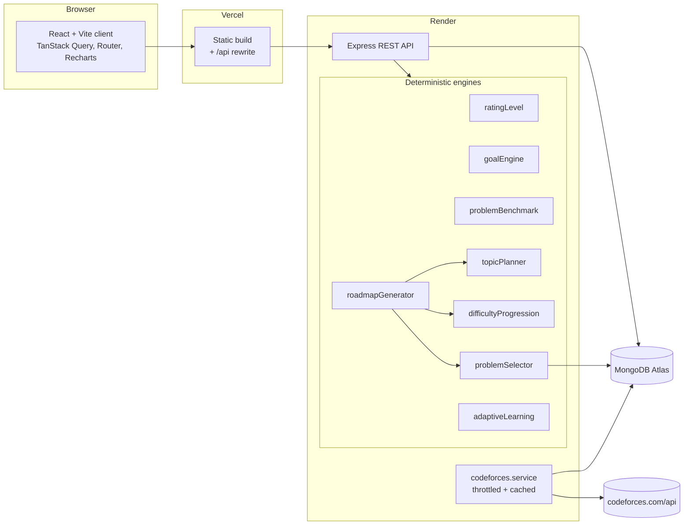

# Architecture

This document is the design reference for Codeforces Growth Planner. Sections
marked *(planned)* describe engines that later milestones will implement; they
are listed here so every milestone builds towards the same design.

## 1. System overview



* **Client** (`client/`): React 19, Vite, TypeScript, Tailwind v4, React Router,
  TanStack Query for server state, Recharts for charts, Lucide icons.
* **Server** (`server/`): Express 5 + TypeScript, Zod validation, JWT auth,
  bcrypt password hashing, Mongoose.
* **Shared** (`shared/`): types and constants used by both sides (API
  contracts, rank names, `BENCHMARK_OFFSET`). No business logic, so the engines
  have one implementation and are tested once, on the server.
* **Database**: MongoDB Atlas. The Codeforces problemset is cached in a
  `problems` collection so roadmap generation never depends on Codeforces being
  up.

### Layering inside the server

`routes → controllers → services → models`

* **Routes** map URLs and attach middleware (auth, validation).
* **Controllers** translate HTTP to service calls; no business rules.
* **Services** hold all logic. Engines are pure functions (input → output, no
  I/O) so they are deterministic and unit-testable. Services that need data
  receive it as arguments or through a small injected repository.
* **Models** are Mongoose schemas with indexes and validation.

## 2. Folder structure

```text
codeforces-growth-planner/
├── package.json            npm workspaces root (shared, server, client)
├── shared/src/             API types + constants
├── server/
│   ├── src/
│   │   ├── config/         env (Zod-validated), db connection
│   │   ├── routes/         Express routers
│   │   ├── controllers/    HTTP handlers
│   │   ├── middleware/     auth, validation, error handling
│   │   ├── models/         Mongoose schemas
│   │   ├── validators/     Zod request schemas
│   │   ├── services/
│   │   │   ├── codeforces.service.ts
│   │   │   ├── ratingLevel.service.ts
│   │   │   ├── goalEngine.service.ts
│   │   │   ├── problemBenchmark.service.ts
│   │   │   ├── topicPlanner.service.ts
│   │   │   ├── difficultyProgression.service.ts
│   │   │   ├── roadmapGenerator.service.ts
│   │   │   ├── adaptiveLearning.service.ts
│   │   │   ├── contest.service.ts, progress.service.ts, analytics.service.ts
│   │   │   └── problemSelector/
│   │   │       ├── fetchProblemset.ts
│   │   │       ├── filterByTopic.ts
│   │   │       ├── filterByDifficulty.ts
│   │   │       ├── calculateProblemScore.ts
│   │   │       ├── ensureVariety.ts
│   │   │       ├── excludePreviouslyAssigned.ts
│   │   │       └── selectDailyProblems.ts
│   │   ├── config/heuristics/   goal table, topic library (data, not code)
│   │   └── utils/
│   └── tests/              Vitest + Supertest
├── client/src/
│   ├── components/  pages/  hooks/  services/  context/  types/  utils/
└── docs/
```

**Change from the suggested layout:** tests live in `server/tests/` rather than
a root `tests/` folder. Every engine under test is server code, and keeping
tests inside the workspace lets Vitest use the server's TypeScript config
directly. Client component tests, if added, would go in `client/`.

## 3. Rating-based level classification

The **only** input to the initial skill level is the current Codeforces rating
(from `user.info` for a handle, or typed in manually). Submission history,
solve counts, tags and accuracy are never fetched or used, not even later for
adaptation.

| Rating    | Rank                          | Classification          |
|-----------|-------------------------------|-------------------------|
| 0–1199    | Newbie                        | Beginner                |
| 1200–1399 | Pupil                         | Basic problem solver    |
| 1400–1599 | Specialist                    | Intermediate            |
| 1600–1899 | Expert                        | Advanced                |
| 1900–2099 | Candidate Master              | Advanced problem solver |
| 2100–2299 | Master                        | High-level training     |
| 2300+     | International Master or above | Advanced training       |

Edge cases:

* **Unrated handle** (no `rating` field, no rated contests): the user is asked
  to enter a starting rating manually, or to confirm "start as a new
  competitor" (treated as rating 0 → Beginner with fundamentals).
* **Below 200**: adds a *programming fundamentals* block (I/O, loops,
  conditionals, arrays, functions) before any algorithmic topic.
* The classification is stored on the roadmap as `startingRating` and is never
  rewritten by feedback.

## 4. Goal engine *(Milestone 2)*

`goalEngine.service.ts` reads the heuristic table (stored as configuration in
`config/heuristics/goals.ts`, not hard-coded in logic) and returns
conservative / recommended / stretch goals for the current rating band.

Validation output:

* `ratingGap = target − current`.
* `difficulty` classification of the selected target relative to the bands:
  `maintenance` (target ≤ current), `conservative`, `recommended`,
  `ambitious` (between recommended and stretch), `very-ambitious` (above
  stretch).
* For `ambitious`/`very-ambitious` a warning explaining why (e.g. "+600 in 90
  days is well above what this plan's heuristics consider realistic"), the
  recommended milestone, and an explicit "continue with my target" path.
* For target below current: a note that this is a maintenance goal.
* Invalid input (negative, non-integer, above a sane cap such as 4000) is
  rejected by Zod.
* Ratings 2000+ are outside the given table; the engine extrapolates with
  smaller gains (+50 / +100 / +150) and labels the result as an extrapolation.

All copy avoids guarantees: goals are "milestones to aim for", never
predictions.

## 5. The "target + 300" benchmark *(Milestone 2)*

`problemSolvingBenchmark = targetRating + 300` (offset in `shared`).

The roadmap keeps four numbers apart, and the UI labels each one:

1. **Target contest rating**: the goal.
2. **Problem-solving benchmark**: target + 300, a long-term stretch level.
3. **Current practice difficulty**: today's mandatory problem band.
4. **Highest independently solved**: user-reported, from progress records.

How the benchmark is used:

* It is the **upper bound for stretch problems**, never for mandatory ones.
* Stretch difficulty starts close to the practice band and widens gradually
  (about +100 early, up to +300 in the final phase), capped at the benchmark.
* Benchmark-level problems appear only in the final phase (and only as
  optional problems), and only if the ramp actually reaches them. For a
  large gap (1000 → 2000) the plan stops wherever 90 days of gradual increase
  takes it and says so, instead of jumping.

## 6. Difficulty progression *(Milestone 5)*

Codeforces problem ratings are multiples of 100 and start at 800. Inputs:
starting rating `R`, target `T`, benchmark `B`, duration, hours per day.

* **Start centre** `s = clamp(roundTo100(R), 800, …)`. For a 1200 user, early
  practice is around 1100–1300.
* **End centre** `e ≈ T` (mandatory problems approach target level by the
  last phase).
* **Curve**: `centre(d) = s + (e − s) · ease(progress(d))`, using a smooth
  ease-in-out so the first two weeks stay near the comfort zone and the climb
  happens in the middle.
* **Band width**: ±100 around the centre, rounded to valid ratings.
* **Hours factor**: with ≤ 1 h/day the ramp is slightly flatter (fewer
  problems means less exposure per level); with ≥ 3 h/day extra time goes
  into more problems, not harder ones.
* **Not monotonic on purpose**: revision days drop back 100–200 and replay
  earlier topics; adaptive feedback (rolling window) can hold or lower the
  curve for the remaining days.

Users below 800 all practise 800-rated problems early (there are no easier
rated problems). For them the difference comes from topic order and from
preferring the most-solved 800s, which are usually the most approachable.

## 7. Topic planning: different roadmaps per rating group *(Milestone 5)*

A topic library (data in `config/heuristics/topics.ts`) defines each topic:

```ts
{
  id: 'binary-search-answer',
  name: 'Binary search on the answer',
  phase: 3,
  prerequisites: ['binary-search-basics', 'sorting'],
  entryRating: 1300,        // where it starts to matter in contests
  cfTags: ['binary search'],
  subtopics: [...],
  concept: '...', objective: '...', whyItMatters: '...',
  baseDays: 3,
}
```

The planner:

1. Computes the window of relevant topics: everything whose `entryRating` is
   at most about the end of the difficulty ramp.
2. Topics far below the starting rating are **compressed into revision** (one
   mixed day instead of a full block); they are not skipped silently.
3. Missing prerequisites are pulled in automatically (topological sort), so no
   topic appears before its foundations.
4. Days are allocated per topic by `baseDays`, scaled to fit the study days
   available, with the remainder given to mixed practice and contests.

Result by group, for example:

| Start          | Roadmap emphasis |
|----------------|------------------|
| 0–199          | Programming fundamentals → implementation, simulation, strings, sorting, basic math; first algorithms (greedy, prefix sums) late. |
| 800–1199       | Short fundamentals revision → brute force, greedy, sorting, prefix sums, two pointers, basic number theory, binary search basics. |
| 1200–1399      | Greedy, binary search (incl. on answer), prefix sums, two pointers, constructive, math, bitmasks, intro DP and graphs. |
| 1600–1899      | Harder constructive, DP (intermediate), graphs (BFS/DFS/DSU/shortest paths), data structures, trees. |
| 1900+          | Advanced DP, segment trees, combinatorics, harder graph and constructive problems. |

## 8. Problem selection *(Milestones 3–4)*

Data comes only from `problemset.problems` (real IDs, names, ratings, tags,
solved counts). URLs are built as
`https://codeforces.com/problemset/problem/{contestId}/{index}`. Problems
without a rating are never assigned; problems tagged `*special` (April Fools
etc.) are excluded.

Five stages per day (all pure functions, deterministic):

1. **Topic relevance**: candidates must carry at least one of the topic's
   `cfTags`. Relevance score is higher when the topic tag is one of few tags
   (a focused problem) and lower for problems with many unrelated tags.
2. **Difficulty filtering**: core and reinforcement problems are drawn from
   the day's band; stretch from `[centre + δ(d), min(B, centre + δ(d) + 100)]`.
3. **Quality**: score = relevance + difficulty fit + a capped
   `log(solvedCount)` signal normalised within the same rating bucket (so 800s
   don't win just for being popular). Missing solved count gets a neutral
   value, not zero.
4. **Variety**: the reinforcement problem must differ from the core problem in
   tag set (Jaccard similarity under a threshold) and come from a different
   contest; the stretch problem may add a second relevant tag.
5. **Exclusion**: everything already in this roadmap, plus the user's manual
   "already solved / exclude" list. Submission history is never read.

Ties are broken by a hash of `(roadmapSeed, problemId)` so the same inputs
always give the same roadmap, while different users don't all get the same
problems. If no candidate fits, the band widens step by step (±100, ±200),
then falls back to a related tag, and the problem card records why.

Replacement uses the same pipeline with the old problem added to the
exclusion set.

## 9. Codeforces API usage *(Milestone 3)*

* `user.info?handles=` for rating/rank; `problemset.problems` for metadata;
  `contest.list?gym=false` for upcoming contests.
* A single in-process queue spaces requests at ≥ 2 s (Codeforces' documented
  limit), with a 10 s timeout and handling for `status: "FAILED"` responses.
* The problemset is stored in MongoDB and refreshed at most once a day; if a
  refresh fails the cached copy is used and its age is reported.
* Handle lookups are cached briefly (about 10 minutes).

## 10. Authentication and security *(Milestone 6)*

* bcrypt (cost 12) password hashes; JWT in an `httpOnly`, `Secure`,
  `SameSite=Lax` cookie.
* In production the Vercel app rewrites `/api/*` to the Render service, so the
  cookie is first-party. This avoids third-party-cookie blocking that would
  break a cross-site cookie.
* Every user-owned query filters by `userId` from the token, never from the
  request body.
* Helmet headers, CORS allow-list, 100 kb JSON limit, Zod on every input,
  rate limiting on auth routes.

## 11. Technical risks and mitigations

| Risk | Mitigation |
|------|------------|
| Codeforces API downtime / rate limits | DB-cached problemset, throttled queue, timeouts, stale-cache fallback. |
| Ratings below 800 have no matching problems | Topic order + most-solved 800s; documented limitation. |
| Tags are noisy (a "greedy" problem may really be DP) | Tags are used for relevance, not as truth; prefer focused problems; Blind Practice hides tags. |
| Not enough candidates for a niche topic at a band | Stepwise band widening and related-tag fallback, recorded on the card. |
| Same problems for every user at the same rating | Seeded deterministic tie-breaking per roadmap. |
| Cross-site cookies blocked between Vercel and Render | Same-origin `/api` rewrite on Vercel. |
| Render free tier cold starts (~30–60 s) | Health endpoint, client loading state, retry. |
| Heuristic goals mistaken for predictions | Clear "heuristic" copy everywhere; tables kept configurable. |
| Monolithic engine code | Small pure modules per stage, unit-tested in isolation. |

## 12. Milestones

1. Architecture and setup *(this milestone)*
2. Rating and goal engine
3. Codeforces API integration and caching
4. Problem selection engine
5. Roadmap generator
6. Backend: auth, models, routes, progress, feedback, contests, analytics
7. Frontend: landing, auth, onboarding, dashboard, roadmap, practice, analytics, settings
8. Integration and end-to-end testing
9. README, screenshots, deployment (after approval)
