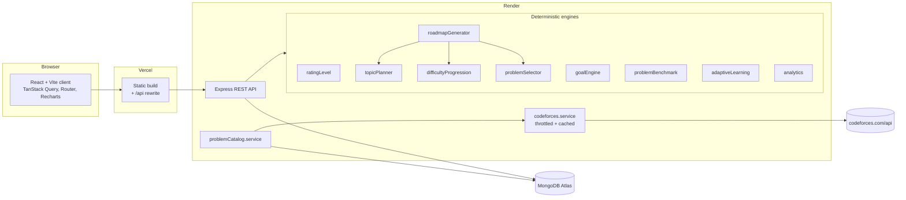

# Architecture

## Overview

- **Client** (`client/`): React 19, Vite, TypeScript, Tailwind 4, React Router, TanStack Query for server state, Recharts (lazy-loaded) for charts.
- **Server** (`server/`): Express 5 + TypeScript, Zod validation, JWT in an httpOnly cookie, bcrypt, Mongoose.
- **Shared** (`shared/`): API types and constants. No business logic, so each engine has one implementation and is tested once, on the server.
- **Database**: MongoDB. The Codeforces problemset is cached in a `problems` collection so roadmap generation keeps working when Codeforces is slow or down.

## Server layering

`routes → controllers → services → models`

- **Routes** (`routes/index.ts`) map URLs and attach `requireAuth` and rate limiting.
- **Controllers** parse input with Zod schemas from `validators/`, call services and map documents to DTOs (`utils/dto.ts`). They hold no business rules.
- **Services** hold the logic. Engines are pure functions:
  - `ratingLevel.service.ts`: rating → rank and classification
  - `goalEngine.service.ts`: goals, difficulty label, warnings
  - `problemBenchmark.service.ts`: target + 300 and the stretch offset
  - `topicPlanner.service.ts`: topic window, prerequisites, day allocation
  - `difficultyProgression.service.ts`: practice and stretch ranges per day
  - `problemSelector/*`: the five selection stages, one file each
  - `roadmapGenerator.service.ts`: assembles the 90 days
  - `adaptiveLearning.service.ts`: rolling-feedback decisions
  - `analytics.service.ts`: analytics and weekly review

  Stateful services wrap the engines: `roadmap.service.ts` (create, regenerate, replace), `progress.service.ts` (outcomes, feedback, adaptation), `contest.service.ts`, `codeforces.service.ts` and `problemCatalog.service.ts`.
- **Container** (`services/container.ts`): the long-lived Codeforces client and problem catalog. Tests replace them with `setServices()`.
- **Models**: Mongoose schemas with validation and indexes.

## Request flow example: generating a roadmap

1. `POST /api/roadmaps/generate` passes `requireAuth`, which sets `req.userId` from the cookie.
2. The controller validates the body (target 0–4000, hours 0.5–12, days 1–7, a handle or a rating).
3. `roadmap.service.createRoadmap` resolves the starting rating: it uses the Codeforces rating when the handle is rated, otherwise the manual rating, and returns 422 for an unrated handle with no manual rating.
4. `ProblemCatalog.getProblems()` returns the cached problemset, refreshing it from Codeforces at most once a day.
5. `generateRoadmap()` produces 90 drafts. The service archives the previous active roadmap, stores the new one and inserts 90 `DailyPlan` documents.

## Security

- Passwords are hashed with bcrypt (cost 12). The hash field is `select: false` and never serialised. Unknown emails are compared against a dummy hash so response timing doesn't reveal which accounts exist.
- Sessions use a JWT (HS256) in an `httpOnly` cookie, `Secure` in production. `SameSite=Lax` works because Vercel proxies `/api` on the same site.
- Every user-owned query includes the `userId` from the token, so other users' resources return 404.
- Helmet headers, a CORS allow-list, a 100 kb JSON limit, Zod on every input, and a rate limit on login, register and account deletion.
- `TRUST_PROXY` sets how many proxy hops to trust, so rate limiting sees the real client IP behind Vercel + Render.
- Unknown errors are logged and returned as a generic 500, never with internals.

## Design decisions

- **Tests live in `server/tests/`** rather than a root `tests/` folder: every engine is server code, and Vitest then uses the server's TypeScript config directly.
- **Assigned problems are snapshotted** on each `DailyPlan` (name, rating, tags, URL) so a plan does not change if Codeforces later edits metadata.
- **Seeded determinism.** Each roadmap stores a random seed. Generation is deterministic for that seed, while different users at the same rating get different problems.
- **Regeneration keeps history.** Settings changes and adaptation regenerate only future days with no outcomes, status or feedback. Kept problems are excluded so nothing repeats.

## Technical risks and mitigations

| Risk | Mitigation |
|---|---|
| Codeforces API downtime or rate limits | Problemset cached in MongoDB with a daily refresh, a single throttled request queue (≥ 2.1 s apart), timeouts, a stale-copy fallback and a 10-minute retry backoff |
| No rated problems below 800 | Beginners use the most-solved 800s, with topic order doing the personalisation; documented |
| Noisy tags | Relevance favours focused problems, fallbacks are explained on the card, and Blind Practice hides tags |
| Too few candidates for a topic at a level | Range widening (±100, ±200) and related-tag fallbacks, recorded in the reason text |
| Same problems for everyone at a rating | Seeded tie-breaking per roadmap |
| Cross-site cookies blocked between Vercel and Render | Same-site `/api` rewrite on Vercel |
| Render free tier cold starts | Health endpoint and loading states in the client |
| Heuristics mistaken for predictions | "Heuristic" wording in the UI and docs, and configurable tables |
