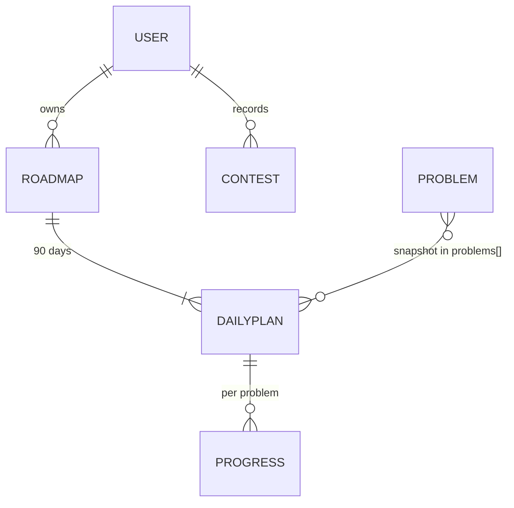

# Database

MongoDB through Mongoose. Models live in `server/src/models/`.

## users

| Field | Type | Notes |
|---|---|---|
| name | string | ≤ 80 chars |
| email | string | unique, lowercase |
| passwordHash | string | bcrypt (cost 12), `select: false` |
| codeforcesHandle | string \| null | |
| currentRating | number \| null | latest known rating (onboarding or a recorded rated contest) |
| excludedProblemIds | string[] | manual "already solved" / "exclude" list |
| preferences.theme | `light` \| `dark` \| `system` | |
| preferences.blindPractice | boolean | |
| createdAt, updatedAt | Date | |

Index: `email` (unique).

## roadmaps

| Field | Notes |
|---|---|
| userId | owner |
| status | `active` \| `archived` \| `completed`; creating a roadmap archives the previous active one |
| codeforcesHandle | handle used at creation, if any |
| startingRating, startingLevel | rating-based classification, never changed by feedback |
| targetRating, conservativeGoal, recommendedGoal, stretchGoal, goalDifficulty | goal assessment at creation (target and difficulty update with settings) |
| problemSolvingBenchmark | target + 300 |
| duration, startDate, endDate | 90 days, `YYYY-MM-DD` |
| hoursPerDay, daysPerWeek, contestParticipation | schedule |
| mandatoryProblems, mandatoryProblemsOverride | effective count, and the user's override (`null` = automatic) |
| seed | random per roadmap; makes generation deterministic; not exposed by the API |
| difficultyOffset | adaptive offset (−200…+200) |
| practiceStart, practiceEnd, rampCapped | difficulty curve summary |
| topics, notes | planned topic sequence and plan notes |
| adaptations[] | `{ date, fromDay, change, offset, reason }` |

Index: `{ userId, status, createdAt }`.

## dailyplans

One document per day (90 per roadmap).

| Field | Notes |
|---|---|
| roadmapId, userId | userId is duplicated so every query can be scoped by owner |
| dayNumber, date, week | |
| type | `learn` \| `practice` \| `revision` \| `contest` \| `assessment` \| `rest` |
| phase, phaseName | 1–6 |
| topicId, topic, subtopic, objective, concept, whyItMatters, prerequisites | learning content |
| topicTags, fallbackTags | tags used for selection, reused when replacing a problem |
| learnMinutes, practiceMinutes | workload |
| difficulty, stretchDifficulty | `{ min, max }` |
| problems[] | snapshot: problemId, contestId, index, name, rating, tags, solvedCount, url, role, mandatory, reason, estimatedMinutes |
| revisionTasks, ifStuck, notes | |
| status | `pending` \| `in-progress` \| `completed` \| `skipped` |
| feedback, feedbackAt | day feedback |

Indexes: `{ roadmapId, dayNumber }` (unique), `{ userId }`.

Assigned problems are embedded as a snapshot rather than referenced, so a plan stays stable if Codeforces changes a problem's metadata later.

## problems

The cached Codeforces problemset.

| Field | Notes |
|---|---|
| problemId | `{contestId}{index}`, unique |
| contestId, index, name | |
| rating | `null` when Codeforces has none (never assigned) |
| tags | may be empty |
| solvedCount | `null` when missing |
| url | `https://codeforces.com/problemset/problem/{contestId}/{index}` |
| metadataUpdatedAt | time of the last refresh; older rows are removed after a refresh |

Indexes: `problemId` (unique), `{ rating, tags }`, `{ metadataUpdatedAt }`.

## progresses

One document per (day, problem) once the user records something.

| Field | Notes |
|---|---|
| userId, roadmapId, dailyPlanId, dayNumber, problemId | |
| problemRating | snapshot for analytics |
| solvingStatus | `not-attempted` \| `solved-independently` \| `solved-with-hint` \| `solved-with-editorial` \| `unable-to-solve` |
| independentSolve | true only for `solved-independently` |
| editorialUsed, hintRevealed | an editorial-assisted solve can't be recorded as independent |
| timeTaken | minutes |
| confidence | 1–5 |
| notes | ≤ 2000 chars |
| completedAt | set when an outcome is recorded |

Indexes: `{ dailyPlanId, problemId }` (unique), `{ userId, roadmapId }`.

## contests

| Field | Notes |
|---|---|
| userId, roadmapId | roadmap is optional |
| contestId | Codeforces contest id, optional |
| contestName, contestDate | |
| kind | `rated` \| `virtual` |
| oldRating, newRating | rated contests only; a new rating also updates `users.currentRating` |
| problemsSolved, upsolvedProblems | 0–20 |
| notes | personal observations |

Index: `{ userId, contestDate }`.

## Data ownership and deletion

- Every query on roadmaps, days, progress and contests includes the authenticated `userId`.
- `DELETE /api/auth/me` (with password confirmation) deletes the user's progress, daily plans, contests, roadmaps and the user document.
- `DELETE /api/roadmaps/:id` deletes that roadmap with its days and progress.
- No submission data, IP addresses or third-party tokens are stored.
